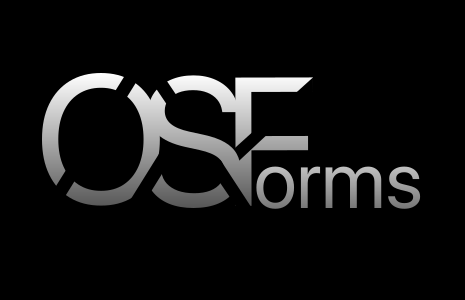
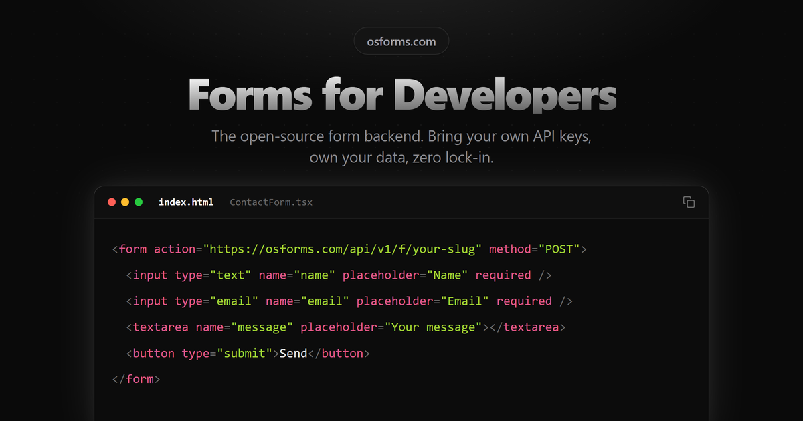

<p align="center">
  <a href="https://osforms.com"></a>
</p>

<h1 align="center">OSForms</h1>

<p align="center"><strong>The open-source form backend where you bring your own API keys.</strong></p>

<p align="center">
  <a href="LICENSE"></a>
  <a href="https://www.npmjs.com/package/@osforms/react"></a>
  <a href="https://github.com/hawkeye-sama/osforms"></a>
  <a href="https://osforms.com"></a>
</p>

<p align="center">
  <a href="https://osforms.com">Website</a> ·
  <a href="https://osforms.com/docs">Docs</a> ·
  <a href="https://osforms.com/signup">Get started free</a> ·
  <a href="SELF_HOSTING.md">Self-host</a>
</p>

**OSForms is an open-source (MIT) form backend for HTML and React forms.** Submissions are stored and sent to your own Resend email, Google Sheets, and webhooks using your own API keys. Because the integrations run on your keys, they are free on every tier: the hosted plan gives you 100 submissions a month with all of them included, and a self-hosted instance runs with limits you set.

<p align="center">
  
</p>

<!-- TODO: replace or add a GIF here: submit a form → new row appears in Google Sheets -->

## Quick start (30 seconds)

1. [Create a free account](https://osforms.com/signup) and create a form. Copy its endpoint URL.
2. Point your form at it.

### Plain HTML

```html
<form action="https://osforms.com/api/v1/f/YOUR_FORM_SLUG" method="POST">
  <input type="text" name="name" placeholder="Name" required />
  <input type="email" name="email" placeholder="Email" required />
  <textarea name="message" placeholder="Message"></textarea>
  <button type="submit">Send</button>
</form>
```

The endpoint accepts `application/x-www-form-urlencoded`, `multipart/form-data`, and JSON. A classic HTML form post gets a `303` redirect to your thank-you page when you set a redirect URL on the form; `fetch` calls with a JSON body (or `Accept: application/json`) get `{ "success": true, "message": "Submission received" }`. Field names are stored as-is, so no schema setup is needed.

### React with [`@osforms/react`](https://www.npmjs.com/package/@osforms/react)

```bash
npm install @osforms/react
```

```tsx
import { OSForm } from '@osforms/react';

export default function ContactPage() {
  // Renders the form you designed in the dashboard Builder, classic or conversational
  return <OSForm formId="YOUR_FORM_SLUG" />;
}
```

`<OSForm />` can also take a `schema` prop (plus `endpoint`) if you'd rather define fields in code, a `mode` of `classic`, `conversational`, or `stepped`, and a `baseUrl` for self-hosted instances. See the [SDK docs](https://osforms.com/docs/sdk/introduction).

## Why OSForms

- **Integrations are free because they run on your keys.** Resend email (with auto-replies), Google Sheets, and webhooks are on the free tier. You pay your provider directly, if anything.
- **You own the data.** Submissions don't expire, export to CSV from any form, and a read-only pull API lets your own code fetch them.
- **Open source, self-hostable.** MIT licensed. `docker compose up` runs the whole stack (Next.js + MongoDB) on your machine or server.
- **Spam protection without a paid plan.** A honeypot field you name, per-form rate limits, and CAPTCHA on your own keys.
- **A conversational React component.** `@osforms/react` renders Typeform-style one-question-at-a-time forms, or classic ones, from the same schema.

## How it compares

Free-tier facts from each vendor's pricing page or repository, checked **Nov 2026**. Prices drift, so follow the links.

|                            | OSForms                     | [Formspree](https://formspree.io/plans) | [Web3Forms](https://web3forms.com/pricing) | [Basin](https://usebasin.com/pricing) | [Formgrid](https://formgrid.dev/pricing)              |
| -------------------------- | --------------------------- | --------------------------------------- | ------------------------------------------ | ------------------------------------- | ----------------------------------------------------- |
| Open source                | Yes (MIT)                   | No (repo archived July 2023)            | No                                         | No                                    | Yes ([MIT](https://github.com/allenarduino/formgrid)) |
| Self-host                  | Yes (Docker Compose)        | No                                      | No                                         | No                                    | Yes (Docker Compose)                                  |
| Free tier                  | 100 submissions/mo          | 50/mo, 30-day archive                   | 250/mo, email delivery                     | 50/mo, 1 form, 30-day retention       | 50/mo, up to 3 forms                                  |
| Google Sheets on free tier | Yes (your Google account)   | No (from $15/mo Personal)               | No (paid plans)                            | No (Growth plan)                      | One-time sync of 10 rows                              |
| Webhooks on free tier      | Yes (optional HMAC signing) | No (from $30/mo Professional)           | No (paid plans)                            | No (Growth plan)                      | No ($29/mo Business)                                  |

Where others win: Web3Forms has more free volume for email-only forms, and Formspree, Basin, and Formgrid store file uploads on paid plans (OSForms doesn't store files at all). The full write-up, including Formcarry, Netlify Forms, and FormSubmit, is at [osforms.com/formspree-alternative](https://osforms.com/formspree-alternative).

## Features

### Integrations (BYOK)

- **Email via Resend**: notification emails to you, plus an optional auto-reply to the submitter, sent with your own Resend API key.
- **Google Sheets**: appends a row per submission through your Google account. New form fields become new columns automatically, alongside `Submission ID` and `Submitted At` columns.
- **Webhooks**: POSTs each submission as JSON to any URL. With a signing secret, requests carry an `X-osforms-Signature` header: the lowercase hex HMAC-SHA256 of the raw body (no `sha256=` prefix).
- Integrations run in the background after the submission is stored, so the form gets an instant response. Failures are logged per submission and raise an in-app notification and an email alert.

### Spam and access control

- Honeypot: you choose the field name in form settings; submissions that fill it are silently dropped.
- Per-form rate limits (default 10 requests/min per IP).
- CAPTCHA on your own keys: Google reCAPTCHA, hCaptcha, or Cloudflare Turnstile.
- CORS allowed origins per form.

### Data

- Redirect to your own thank-you page after an HTML form post.
- CSV export of every form's submissions.
- Pull API: `GET /api/v1/submissions?formId=...` with a read-only `osf_live_` API key, scoped to the forms you choose. Cursor-paginated, never returns IP or user-agent metadata.
- Integration keys encrypted at rest with AES-256-GCM, decrypted only when an integration runs.
- Dashboard with submission analytics and per-submission integration logs.

**Limitations:** uploaded files are not stored. Multipart posts are accepted, but each file is replaced with a placeholder like `[File: resume.pdf, 48210 bytes]`. The hosted free tier is 100 submissions a month.

## Self-host in one command

```bash
git clone https://github.com/hawkeye-sama/osforms.git
cd osforms
cp .env.docker.example .env          # then generate the two secrets it lists
docker compose up
```

That builds the app, starts MongoDB, and serves OSForms at [http://localhost:3000](http://localhost:3000). Config lives in `.env` (secrets stay out of tracked files); `MONGODB_URI` defaults to the bundled mongo service. Every account still starts at 100 submissions a month, stored on the user record, so raise it in MongoDB after signup. The full walkthrough (generating secrets, your domain, integrations, the submission limit, and deploying to Vercel + MongoDB Atlas, which is what osforms.com runs on) is in **[SELF_HOSTING.md](SELF_HOSTING.md)**.

OSForms runs anywhere Next.js runs. On a long-running server (Docker, a VPS) background integrations run in-process with no time cap. On Vercel they use `waitUntil`, capped at ~10s on Hobby and up to 60s on Pro.

### Forking and staying in sync

Forks ship with a scheduled GitHub Action ([.github/workflows/sync-fork.yml](.github/workflows/sync-fork.yml)) that keeps your fork's `main` up to date with upstream automatically. It only runs on forks, never on the upstream repo. Enable Actions on your fork once and it runs daily. See [SELF_HOSTING.md → Keep your fork in sync](SELF_HOSTING.md#keep-your-fork-in-sync).

## Developer setup

### Repository layout

OSForms is a [pnpm](https://pnpm.io) + [Turborepo](https://turbo.build) monorepo:

```text
.
├── apps/
│   ├── web/        # The Next.js 15 app: dashboard, API, public submission endpoint
│   ├── docs/       # Mintlify documentation site (osforms.com/docs)
│   └── playground/ # Vite sandbox for trying @osforms/react against your local app
├── packages/
│   ├── react/      # @osforms/react, the published React SDK
│   └── types/      # @osforms/types, shared TypeScript types
├── docker-compose.yml   # Docker self-host: MongoDB + the web app
└── turbo.json
```

The app source lives in [apps/web/src](apps/web/src). The environment file lives at [apps/web/.env.example](apps/web/.env.example).

### Prerequisites

- **Node.js 20+**
- **pnpm 10+**: `corepack enable` (ships with Node) or `npm i -g pnpm`
- **Docker** (for local MongoDB) or a MongoDB connection string

### Setup

```bash
# 1. Clone (or your fork)
git clone https://github.com/hawkeye-sama/osforms.git
cd osforms

# 2. Install all workspace dependencies
pnpm install

# 3. Create your env file (note the path: it's inside apps/web)
cp apps/web/.env.example apps/web/.env
```

Edit `apps/web/.env`. At minimum you need:

```bash
MONGODB_URI=mongodb://localhost:27017/osforms
JWT_SECRET=any-long-random-string
ENCRYPTION_KEY=<64-char hex string>   # node -e "console.log(require('crypto').randomBytes(32).toString('hex'))"
NEXT_PUBLIC_APP_URL=http://localhost:3000
```

Google and Resend keys are optional. See [Environment variables](#environment-variables).

### Run

```bash
# Start only MongoDB (plain `docker compose up` also builds the web app on port 3000)
docker compose up -d mongodb

# Build the workspace packages once (the web app imports @osforms/react)
pnpm build --filter @osforms/react

# Start the dev server
pnpm dev
```

Open [http://localhost:3000](http://localhost:3000), create an account, and complete onboarding.

> `pnpm dev` runs Turborepo, which starts the Next.js app, rebuilds `@osforms/react` in watch mode, and serves the SDK playground at [http://localhost:3001](http://localhost:3001). Building the package once first avoids a first-run race where the app boots before the SDK is built.

### Environment variables

All variables live in `apps/web/.env` (copy from [apps/web/.env.example](apps/web/.env.example)).

| Variable                         | Description                                                     | Required |
| -------------------------------- | --------------------------------------------------------------- | -------- |
| `MONGODB_URI`                    | MongoDB connection string                                       | Yes      |
| `JWT_SECRET`                     | Secret for signing JWT auth tokens                              | Yes      |
| `ENCRYPTION_KEY`                 | 64-char hex string (32 bytes) for AES-256-GCM                   | Yes      |
| `NEXT_PUBLIC_APP_URL`            | Public URL: OAuth callback, endpoint URLs, email links, sitemap | Yes      |
| `GOOGLE_CLIENT_ID`               | Google OAuth client ID (Google Sheets only)                     | No       |
| `GOOGLE_CLIENT_SECRET`           | Google OAuth client secret                                      | No       |
| `RESEND_API_KEY`                 | System emails only (OTP, welcome, failure alerts)               | No       |
| `RESEND_EMAIL_SIGNING_SECRET`    | osforms.com's inbound forwarding only; leave blank              | No       |
| `NEXT_PUBLIC_RECAPTCHA_SITE_KEY` | reCAPTCHA v3 site key for signup spam protection                | No       |
| `RECAPTCHA_SECRET_KEY`           | reCAPTCHA v3 secret; turns the signup CAPTCHA on                | No       |
| `RECAPTCHA_MIN_SCORE`            | Minimum reCAPTCHA score to allow signup (default 0.5)           | No       |

> `RESEND_API_KEY` is not used by the Resend email integration; each integration stores its own key.
>
> System emails are sent from hardcoded `@osforms.com` addresses, so a self-hosted instance can't deliver them yet, even with your own Resend key (and without one, signup returns a 500 after saving your account). The OTP is never logged. To verify, read the latest code from MongoDB and enter it at `/verify-email?email=<your email>`. See [SELF_HOSTING.md → Verify your account without email](SELF_HOSTING.md#verify-your-account-without-email).

Running a public instance? Turn on the optional signup CAPTCHA to block bot accounts. See [Signup spam protection](SELF_HOSTING.md#signup-spam-protection-optional).

### Scripts

Scripts run from the repo root via Turborepo (they fan out to every workspace package):

```bash
pnpm dev                # Start the app, SDK watch build, and playground
pnpm build              # Production build of all packages
pnpm lint               # ESLint with --fix (rewrites files); typechecks the SDK packages, not the web app
pnpm turbo lint:check   # Lint without fixing + typecheck web, react, and types
pnpm format             # Format with Prettier
pnpm format:check       # Check formatting
```

Target a single package with `--filter`, e.g. `pnpm build --filter @osforms/web`.

### Tech stack

| Layer           | Technology                                   |
| --------------- | -------------------------------------------- |
| Framework       | Next.js 15 (App Router)                      |
| Monorepo        | pnpm workspaces + Turborepo                  |
| Database        | MongoDB + Mongoose                           |
| Auth            | Email/password + OTP verification + JWT      |
| Encryption      | AES-256-GCM (Node crypto)                    |
| Styling         | Tailwind CSS + shadcn/ui                     |
| Integrations    | Resend, Google Sheets (googleapis), Webhooks |
| Background jobs | `@vercel/functions` waitUntil                |
| Charts          | Recharts                                     |
| SDK             | `@osforms/react` (built with tsup)           |

## Not to be confused with

OSForms (osforms.com, `@osforms/react`) is unrelated to **OS2Forms**, **Open Forms**, and **OpnForm**, which are separate projects.

## Contributing

Contributions are welcome. See [CONTRIBUTING.md](CONTRIBUTING.md) for environment setup, code style, and how to open a pull request. Found a bug? [Open an issue](https://github.com/hawkeye-sama/osforms/issues).

## License

MIT. See [LICENSE](LICENSE).

## Links

- [Live site](https://osforms.com)
- [Documentation](https://osforms.com/docs)
- [npm: @osforms/react](https://www.npmjs.com/package/@osforms/react)
- [Report an issue](https://github.com/hawkeye-sama/osforms/issues)

If OSForms saves you a monthly bill, a ⭐ helps other developers find it.
